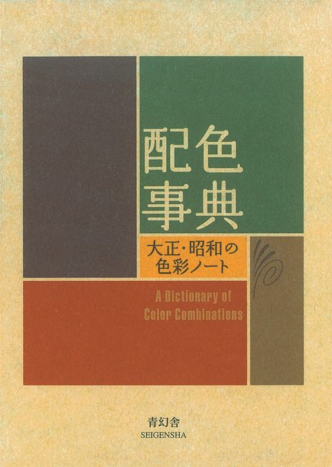
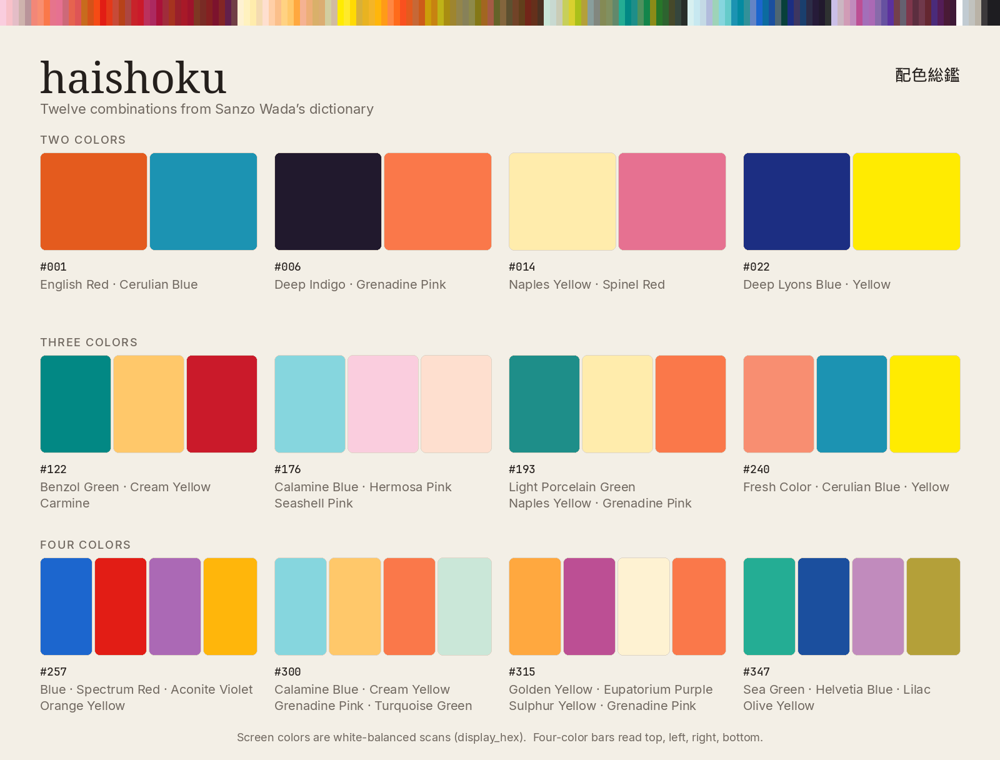

<p align="center">
  <a href="https://en.seigensha.com/books/978-4-86152-247-5/">
    
  </a>
</p>

<p align="center">
  <sub>Cover of the Seigensha edition, shown small so the book can be identified. The cover and the book are © Seigensha Art Publishing, Inc. This project is not affiliated with the publisher. <a href="assets/ATTRIBUTION.md">Attribution</a>.</sub>
</p>

<h1 align="center">haishoku</h1>

<p align="center">
  Open data for the 348 color combinations and 159 named colors<br>
  in Sanzo Wada’s <em>A Dictionary of Color Combinations</em>.
</p>

<p align="center">
  <a href="LICENSE"></a>
  <a href="LICENSE-DATA"></a>
  
  
  <a href="https://bjoseph23.github.io/haishoku/viewer/"></a>
</p>

<p align="center">
  <a href="https://bjoseph23.github.io/haishoku/viewer/"><strong>Open the live viewer</strong></a>
  &nbsp;·&nbsp;
  <a href="data/colors.csv">colors.csv</a>
  &nbsp;·&nbsp;
  <a href="data/combinations.csv">combinations.csv</a>
  &nbsp;·&nbsp;
  <a href="data/wada_colors_and_combinations.json">JSON</a>
  &nbsp;·&nbsp;
  <a href="docs/AI_GUIDE.md">Use with AI</a>
</p>

Sanzo Wada (和田三造, 1883–1967) was a Japanese painter, art teacher, and designer of costume, kimono, and fashion. In 1927 he founded the Japan Standard Color Association, now the Japan Color Research Institute. He later received the 1954 Academy Award for Best Costume Design for *Gate of Hell*, and in 1958 was named a Person of Cultural Merit.

His color study *Haishoku Soukan* (配色総鑑, 1933–34) set out 159 named colors in 348 combinations of two, three, and four. Seigensha republished that work in July 2010 as the bilingual pocket book *A Dictionary of Color Combinations* (配色事典, ISBN 978-4-86152-247-5, 352 pages). This repository is an independently checked transcription of that edition: every swatch was sampled from the page, matched to the 159 reference colors, and checked against the printed English name.

The combinations were made for seeing, and they travel. The same balances of temperature, value, and proportion are used in clothing, rooms, buildings, identities, interfaces, illustration, products, charts, and events.

<p align="center">
  
</p>

<p align="center">
  <sub>Twelve of the 348 combinations, drawn from <code>display_hex</code>. The strip above them is every named color, in the book’s reference order. Regenerate it with <code>python scripts/generate_preview.py</code>.</sub>
</p>

## What this is

A small, verified color dataset and the files around it:

- **159 named colors**, with the CMYK values printed in the book and three RGB hex readings.
- **348 combinations** — 120 of two colors, 120 of three, and 108 of four — in the order they appear on the page.
- A **palette viewer** you can open in a browser, plus CSV for spreadsheets, JSON for code and AI, and ready-made palettes for CSS, Tailwind, GIMP, and Adobe.

For anything on a screen, use **`display_hex`**. It is the scanned reference swatch after a white balance that makes the paper read as white. `scan_hex` is the same swatch before that balance (the scan has a blue-gray cast). `hex_cmyk` is a plain conversion of the printed ink percentages and runs hot. The CMYK numbers themselves are the inks as printed.

| You want to… | Open |
| --- | --- |
| Look, search, and copy a hex | [Live viewer](https://bjoseph23.github.io/haishoku/viewer/), or [`viewer/index.html`](viewer/index.html) on your computer |
| Sort and filter in Excel or Google Sheets | [`data/colors.csv`](data/colors.csv), [`data/combinations.csv`](data/combinations.csv) |
| Drop a color into Canva or Figma | The viewer. Click a swatch, paste the hex into the color field |
| Load swatches in Illustrator or Photoshop | [`data/derived/haishoku-rgb.ase`](data/derived/haishoku-rgb.ase) (screen) or [`haishoku-cmyk.ase`](data/derived/haishoku-cmyk.ase) (printed inks) |
| Use the palette in GIMP or Inkscape | [`data/derived/haishoku.gpl`](data/derived/haishoku.gpl) |
| Style a website | [`data/derived/colors.css`](data/derived/colors.css) |
| Feed a program or an AI assistant | [`data/wada_colors_and_combinations.json`](data/wada_colors_and_combinations.json) |

## Quick start for everyone else

**Viewer.** Download the repository (Code → Download ZIP) and double-click `viewer/index.html`, or clone and open that file. It loads `viewer/palette-data.js` from the same folder, so it works from your desktop with no server. Search by name, hex, or combination number. Filter to 2, 3, or 4 colors. “Book colors” shows `display_hex`. “CMYK colors” shows the plain ink conversion. Click a swatch to copy one hex. Click the caption to copy every hex in the combination. Click a color’s name in the grid below to list every combination that uses it.

The hosted viewer is [bjoseph23.github.io/haishoku/viewer/](https://bjoseph23.github.io/haishoku/viewer/). GitHub’s own file view shows the HTML source and does not run the page.

**Spreadsheets.** Download the two CSVs. In Excel, open them directly. In Google Sheets, use File → Import → Upload. The column to copy into a design tool is `display_hex`. In `combinations.csv`, filter `size` to `2`, `3`, or `4`. Empty `color_3` / `color_4` cells mean the combination is shorter than four. Four-color rows are ordered top, left, right, bottom — the way the book prints them, as a cross.

**Canva, Figma, and other design tools.** Copy a hex from the viewer (`#E45B1E`) and paste it into the tool’s hex field. Canva’s color picker and Figma’s fill both accept it. For a whole combination, click the caption and paste the list beside your frame so the set stays together.

**Adobe.** In Illustrator or Photoshop: Swatches panel menu → Open Swatch Library → Other Library, and choose `haishoku-rgb.ase`. The file has one group of all 159 colors and one group per combination (`Combo 001` … `Combo 348`). Use `haishoku-cmyk.ase` when you are specifying the book’s ink percentages for print. Those CMYK values are what the book prints. They are a different thing from converting `display_hex` back into CMYK.

**GIMP and Inkscape.** Windows → Dockable Dialogs → Palettes → menu → Import a palette, and choose `haishoku.gpl`. The RGB values are `display_hex`.

## Quick start for developers

The JSON file is the canonical record. Both CSVs carry the same colors and combinations in a flat shape. Derived files are generated from the JSON; regenerate them rather than editing them.

### Python

From the repository root, no install required:

```python
import json
from pathlib import Path

data = json.loads(Path("data/wada_colors_and_combinations.json").read_text())

combo = data["combinations"][0]  # combination 1, English Red + Cerulian Blue
for slot in combo["colors"]:
    print(slot["name"], slot["display_hex"])
```

A two-color row from the CSV, with only the standard library:

```python
import csv
from pathlib import Path

with Path("data/combinations.csv").open(newline="", encoding="utf-8") as handle:
    row = next(csv.DictReader(handle))

print(row["number"], row["color_1"], row["display_hex_1"], row["color_2"], row["display_hex_2"])
```

### JavaScript

`raw.githubusercontent.com` sends the headers a browser needs for `fetch`, once this repository is public:

```javascript
const url =
  "https://raw.githubusercontent.com/Bjoseph23/haishoku/main/data/wada_colors_and_combinations.json";

const data = await fetch(url).then((response) => response.json());

const palette = data.combinations
  .find((combo) => combo.number === 176)
  .colors.map((slot) => slot.display_hex);
// ["#86D6DE", "#FACDDE", "#FEDFCF"]  Calamine Blue, Hermosa Pink, Seashell Pink
```

### CSS

Copy `data/derived/colors.css` into the project and link it. Importing the file from GitHub on every page view is a brittle dependency; host the file yourself.

```css
@import "colors.css";

.room {
  background: var(--haishoku-seashell-pink); /* #FEDFCF */
  color: var(--haishoku-deep-indigo);        /* #21192D */
}
```

Each name is lowercased, with punctuation turned into hyphens: `--haishoku-eugenia-red-variant-b`, `--haishoku-vandar-poels-blue`. Combination classes live in `data/derived/combinations.css`:

```css
.haishoku-combo-001 {
  --haishoku-1: #E45B1E; /* English Red */
  --haishoku-2: #1C93B2; /* Cerulian Blue */
}
```

`--haishoku-1` is the first color in book order. For a four-color combination that is the top of the cross, then left, right, and bottom.

Tailwind CSS, in `tailwind.config.js`:

```javascript
const haishoku = require("./data/derived/tailwind.colors.json");

module.exports = {
  theme: {
    extend: {
      colors: { haishoku },
    },
  },
};
```

That exposes utilities such as `bg-haishoku-cerulian-blue`. A Sass map of the same colors is `data/derived/colors.scss` (`$haishoku-colors`). A one-line lookup of printed name to hex is `data/derived/display-hex.json`.

Check the dataset after any edit:

```bash
python scripts/validate_data.py
python scripts/generate_derived.py   # refresh CSS, ASE, GPL, and the viewer data
python scripts/generate_preview.py   # refresh assets/preview.png; needs Pillow
```

## Use with AI assistants

Upload `data/wada_colors_and_combinations.json`, or both CSVs, at the start of the chat. Ask the model to choose only from those combinations and to quote `display_hex` plus the combination number. A ready-to-paste system prompt for ChatGPT custom GPTs and Claude Projects, plus more prompts, is in [docs/AI_GUIDE.md](docs/AI_GUIDE.md). Machines that fetch a short index first can read [`llms.txt`](llms.txt).

**Interior.** “Using only the attached Haishoku file, choose one 3-color combination for a north-facing living room with oak floors. Give the combination number, the color names, `display_hex`, and a 60/30/10 split across walls, upholstery, and small objects. Explain the choice in two sentences.”

**Outfit.** “Pick two 2-color combinations from the file that can share a wardrobe: one for a coat and scarf, one for a shirt and tie. Return names, combination numbers, and `display_hex`. Keep the printed spellings.”

**Brand.** “Propose a brand palette for a small ceramics studio. Choose one combination, assign logo, packaging, and a quiet background, and give `display_hex`. Stay inside the file.”

The same file works in Gemini, or in an agent that can read the repository. Point the agent at `llms.txt` and the JSON, and tell it that `display_hex` is the screen color.

## Where the combinations get used

Wada printed the swatches at equal size. In a room, a poster, or an interface you assign the area. A practical default is **60/30/10**: about 60% of the surface in the quietest color, 30% in the second, 10% in the accent. Two-color pairs often want something closer to 80/20 when one color is very dark or very bright. Four-color sets still need a dominant; the cross in the book is a specimen, and the layout you design gives the colors their weight.

[docs/USE_CASES.md](docs/USE_CASES.md) walks through fashion, interiors, architecture, branding, web and UI, illustration, product design, data visualization, and events, with worked combinations and contrast notes. Historical pairs can be beautiful as large fields and still fail as small text. Deep Indigo `#21192D` on Seashell Pink `#FEDFCF` is about 13:1. English Red `#E45B1E` on Cerulian Blue `#1C93B2` is about 1:1 — a strong pair of shapes, and a poor pair for type.

## Repository structure

```
.
├── README.md
├── llms.txt                         short index for language models
├── LICENSE                          MIT, for code
├── LICENSE-DATA                     CC BY 4.0, for the compilation
├── CITATION.cff
├── assets/
│   ├── cover.jpg                    Seigensha cover, for identification
│   ├── preview.png                  generated specimen sheet
│   └── ATTRIBUTION.md
├── data/
│   ├── colors.csv                   159 colors, one row each
│   ├── combinations.csv             348 combinations, one row each
│   ├── wada_colors_and_combinations.json
│   └── derived/                     generated from the JSON
│       ├── colors.css               custom properties, display_hex
│       ├── combinations.css         one class per combination
│       ├── colors.scss
│       ├── tailwind.colors.json
│       ├── display-hex.json         { "Hermosa Pink": "#FACDDE", ... }
│       ├── haishoku.gpl             GIMP / Inkscape
│       ├── haishoku-rgb.ase         Adobe, screen colors
│       └── haishoku-cmyk.ase        Adobe, printed ink values
├── viewer/
│   ├── index.html                   the palette viewer
│   └── palette-data.js              generated copy of the JSON
├── docs/
│   ├── AI_GUIDE.md
│   ├── DATA_DICTIONARY.md
│   ├── METHODOLOGY.md
│   └── USE_CASES.md
└── scripts/
    ├── validate_data.py
    ├── generate_derived.py
    ├── generate_preview.py
    ├── haishoku.py
    └── requirements.txt             Pillow, only for the preview
```

`index.html` at the repository root redirects to the viewer so a GitHub Pages site opens on the palettes.

## Data dictionary

Full definitions, nested JSON fields, and worked rows are in [docs/DATA_DICTIONARY.md](docs/DATA_DICTIONARY.md). Every column is listed here.

Names are the English names printed in the Seigensha edition, including historical spellings (Cerulian Blue, Antwarp Blue, Vandar Poel's Blue, Vistoris Lake, Kronbergs Green) and two pairs of variants: Eugenia Red (a / b) and Grayish Lavender (a / b). Slash names such as Mars Brown/Tobacco are printed that way. Japanese names are not in this release; the OCR of those labels was too noisy to publish.

### `data/colors.csv`

One row per named color, ids 1–159, in reference-swatch order.

| Column | What it holds |
| --- | --- |
| `id` | Color number, 1–159. |
| `name` | English name as printed. |
| `c`, `m`, `y`, `k` | Printed ink percentages, integers 0–100. |
| `hex_cmyk` | Naive CMYK → RGB of those percentages. Uppercase `#RRGGBB`. Kept so older notes still match. Hot on screen. |
| `scan_hex` | Raw color of the reference swatch in the scan, before white balance. |
| `display_hex` | That swatch, white-balanced so the paper reads as white. **Use this on screen.** |
| `ref_page` | Page of the reference swatch in the scan (285–351). |
| `combo_count` | How many combinations include this color. |
| `appears_in` | Those combination numbers, space-separated and zero-padded (`027 043 087`). |
| `note` | Blank, except Etruscan Red (id 19), whose black plate is K6. |

### `data/combinations.csv`

One row per combination, numbers 001–348. Slots 3 and 4 are empty when the combination is shorter.

| Column | What it holds |
| --- | --- |
| `number` | Combination number, zero-padded (`001`). |
| `size` | `2`, `3`, or `4`. |
| `page` | Page in the scan. Two-color: 28–87. Three-color: 90–149. Four-color: 152–259. |
| `color_1` … `color_4` | English names in book order. |
| `display_hex_1` … `display_hex_4` | `display_hex` of each slot. |
| `hex_cmyk_1` … `hex_cmyk_4` | `hex_cmyk` of each slot. |
| `positions` | `left/right`, `left/middle/right`, or `top/left/right/bottom`. |
| `confidence` | `verified-visual` for all 348 rows in this release. |
| `notes` | How the row was confirmed (back index, and variant choice where the book has two). |

### `data/wada_colors_and_combinations.json`

`meta` describes the source, the three hex fields, the matching method, and the position rule.

Each **color** object has the CSV fields plus `base` (the name with a variant suffix removed, so both Eugenia Reds share a base), `scan_rgb` (the raw scan as `[R, G, B]`), and `appears_in` as an array of integers. `combo_count` is the length of that array and is stored only in the CSV.

Each **combination** object has `number`, `size`, `page`, `positions` (an array), `confidence`, `notes`, and `colors`. Each slot inside `colors` has:

| Field | What it holds |
| --- | --- |
| `id`, `name` | The reference color. |
| `display_hex`, `scan_hex`, `hex_cmyk` | Copies of the color record, so a combination is readable on its own. |
| `page_sample_hex` | The color sampled from *this* swatch on the combination page, before it was matched to the reference. |
| `label_ocr_match` | String similarity (0–1) between the OCR of the printed label and the color name. Below 1.0 is usually a clipped word or a missing apostrophe, and it is a separate fact from whether the label and the swatch agreed. |
| `delta_e` | CIEDE2000 distance between the page swatch and that color’s reference swatch. |

## Accuracy and limits

The method is written out in [docs/METHODOLOGY.md](docs/METHODOLOGY.md). In short: every swatch was sampled, the English label under it was read with OCR, and the two had to point at the same one of the 159 reference colors. They agreed on 1,028 of 1,032 slots. The other four — one slot in combination 050, one in 112, and two in 132 — were resolved from the swatch, the back index, and a look at the page. An independent public dataset, [mattdesl/dictionary-of-colour-combinations](https://github.com/mattdesl/dictionary-of-colour-combinations), assigns the same colors to the same combinations on all 1,032 slots, including the Eugenia Red and Grayish Lavender variants.

A few limits are worth keeping in view:

- **Screen colors are approximate.** `display_hex` comes from one scan and one global white balance. Expect a small cast. It is much closer to the printed page than `hex_cmyk`, and it is still a photograph of ink, not a spectrophotometer reading.
- **Three darks sit on top of each other on screen.** Deep Indigo `#21192D`, Black `#1E1D21`, and Dull Violet Black `#261B39` are easy to tell apart in the book and hard to tell apart on a display. Their CMYK recipes are very different (Black is `20 10 15 100`; Deep Indigo is `100 92 52 60`). If a design depends on which dark you mean, say the name.
- **White is `#FDFDFD` in `display_hex` and `#FFFFFF` in `hex_cmyk`.** The scan never quite reaches a pure monitor white.
- **Print and screen are different media.** Handing `display_hex` to a CMYK profile will not reproduce the book. For print specification, start from the printed `c m y k` values.
- **The names are the book’s names.** They are kept on purpose, odd spelling included.

Etruscan Red (color 19) is `C16 M80 Y74 K6`. The reference swatch page prints K6. The back-index table prints K0. This dataset follows the swatch page. The other 158 CMYK recipes match their reference pages.

## Credits and references

- **Sanzo Wada**, *Haishoku Soukan* (配色総鑑), 1933–34. The combinations.
- **Seigensha Art Publishing**, *A Dictionary of Color Combinations* (配色事典), July 2010, ISBN 978-4-86152-247-5. The bilingual edition these pages were read from. [Publisher’s page](https://en.seigensha.com/books/978-4-86152-247-5/).
- **Bill Mageni** ([@Bjoseph23](https://github.com/Bjoseph23)), maintainer. He compiled and checked this dataset.
- **Matt DesLauriers**, [dictionary-of-colour-combinations](https://github.com/mattdesl/dictionary-of-colour-combinations). Used as an independent check of which color belongs to which combination. This repository’s swatch colors, CMYK corrections, and `display_hex` values are a separate reading of the pages.

## License

Two licenses, for two kinds of file.

- **Code** — the viewer, the scripts, and this documentation’s markup — is [MIT](LICENSE). Copyright © 2026 Bill Mageni.
- **The data compilation** — the CSV and JSON files and the palette files generated from them — is [CC BY 4.0](LICENSE-DATA). Attribute Bill Mageni and link to this repository. Please also credit Sanzo Wada when you show the combinations as his.

The underlying combinations come from Wada’s 1933–34 work. The 2010 book, its cover, its layout, and its prose belong to its publishers. This project is an independently verified transcription of the colors and their groupings. It does not include the book, and the cover image is used only to identify the edition. See [assets/ATTRIBUTION.md](assets/ATTRIBUTION.md).

## Contributing

Corrections are welcome, especially a color assigned to the wrong combination or a CMYK value copied wrong. Open an issue with the combination number and the color name. Please describe the correction in words. Do not attach the book PDF or page scans.

If you change the JSON or the CSVs, run `python scripts/validate_data.py` and commit the regenerated files from `python scripts/generate_derived.py`. Details are in [CONTRIBUTING.md](CONTRIBUTING.md). The code of conduct is [CODE_OF_CONDUCT.md](CODE_OF_CONDUCT.md).

## Citation

Cite the compilation, and credit Wada for the work it transcribes.

```bibtex
@dataset{mageni2026haishoku,
  author    = {Mageni, Bill},
  title     = {Haishoku: a verified data compilation of Sanzo Wada's color combinations},
  year      = {2026},
  version   = {1.0.0},
  url       = {https://github.com/Bjoseph23/haishoku},
  license   = {CC-BY-4.0}
}
```

```bibtex
@book{wada2010dictionary,
  author    = {Wada, Sanzo},
  title     = {A Dictionary of Color Combinations},
  publisher = {Seigensha},
  address   = {Kyoto},
  year      = {2010},
  isbn      = {978-4-86152-247-5},
  note      = {Bilingual republication of Haishoku Soukan (1933--34)}
}
```

GitHub can also build a citation from [`CITATION.cff`](CITATION.cff).

## GitHub Pages

The viewer is published from this repository:

**https://bjoseph23.github.io/haishoku/viewer/**

The site root redirects there. [`.github/workflows/pages.yml`](.github/workflows/pages.yml) deploys on every push to `main`, with Pages set to build from GitHub Actions. A public repository is what makes the raw JSON links and the Pages site available without a login. The validation workflow runs on its own.
